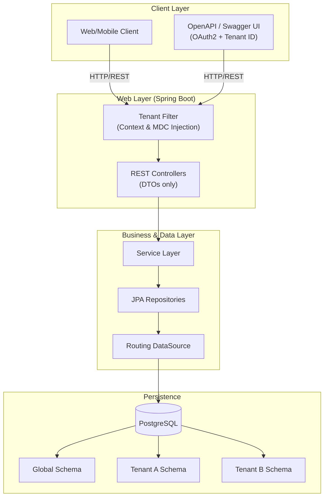
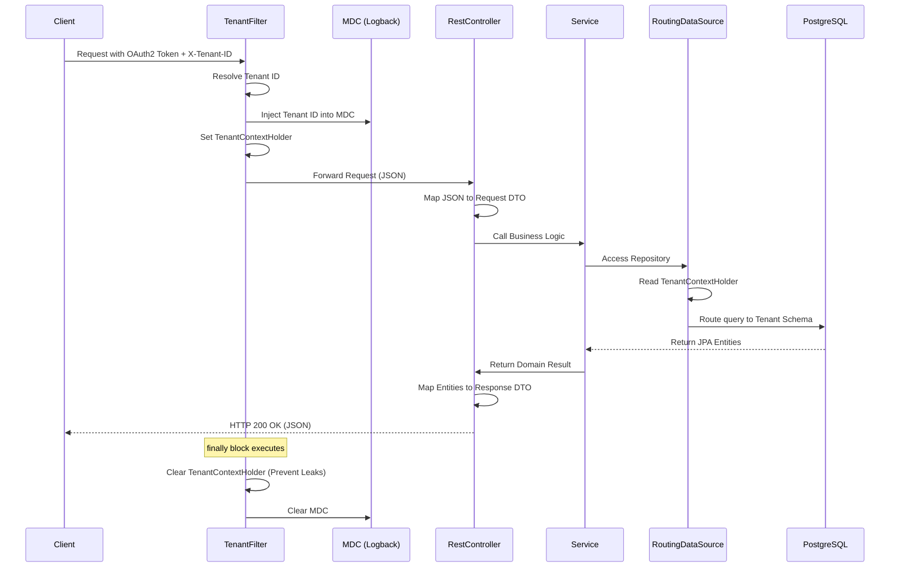

# <samp>Tetoca API<samp>

A **Spring Boot Multi-Tenant SaaS platform** providing a scalable and isolated RESTful API architecture. It is built to guarantee robust data separation across tenants, maintain high maturity in REST integrations, and ensure enterprise-grade observability and zero-downtime database evolutions.

Built on **Spring Boot 3.5.0**, the system relies on Schema-based Multi-Tenancy, strict DTO boundaries, and immutable Flyway migrations to serve multiple organizations securely and efficiently.

## Table of Contents

- [The Problem](#the-problem)
- [Architecture Overview](#architecture-overview)
- [Data Flow](#data-flow)
- [Components](#components)
- [Multi-Tenancy Strategy](#multi-tenancy-strategy)
- [Observability & Logging](#observability--logging)
- [Quick Start](#quick-start)
- [Documentation](#documentation)

## The Problem

SaaS applications face the constant challenge of ensuring absolute data isolation among different clients (tenants) without sacrificing performance or maintainability. Exposing persistence entities directly in APIs tightly couples the internal database schema to public contracts, leading to brittle integrations.

Tetoca API solves this by enforcing **strict multi-tenant schema isolation**, mandating the use of **Data Transfer Objects (DTOs)** for all client interactions, and managing automated, immutable schema updates seamlessly.

## Architecture Overview

The system strictly decouples the web layer from persistence, utilizing a dynamic routing datasource that resolves the tenant context on every request.



**Client Layer** interacts with the system using standard OAuth2 protocols, explicitly passing the Tenant ID (typically via HTTP headers). 
**Web Layer** captures the context, sets up the `TenantContextHolder`, and populates MDC for logging. Only DTOs are serialized/deserialized here.
**Data Layer** dynamically routes queries to the correct isolated database schema based on the resolved context.

## Data Flow

The following diagram demonstrates a typical authenticated request lifecycle interacting with the isolated tenant data:

<details>
<summary><b>Click to expand the Data Flow sequence diagram</b></summary>
<br>



</details>

## Components

| Component | Technology | Responsibility |
|:---|:---|:---|
| **API Gateway / Filter** | Spring Web | Intercepts requests, validates OAuth2 tokens, and sets `TenantContextHolder`. |
| **REST Controllers** | Spring MVC | Exposes OpenAPI documented endpoints using strict DTO parameters and responses. |
| **Service Layer** | Spring Service | Contains business logic; strictly separated from web and persistence contexts. |
| **Migration Engine** | Flyway | Manages immutable schema definitions (`db/migration/global` and `db/migration/tenant`). |
| **Routing DataSource** | Spring Data JPA | Dynamically selects the active PostgreSQL schema per tenant context. |
| **Testing Engine** | Testcontainers | Spins up isolated PostgreSQL instances for accurate integration testing. |

## Multi-Tenancy Strategy

Tetoca API enforces **Schema Isolation** (a database per tenant or schema per tenant model). 

1. **Context Management**: The `TenantContextHolder` stores the active tenant context. It is strictly cleared in a `finally` block of the web filter to prevent ThreadLocal leaks during Tomcat/Netty thread reuse.
2. **Immutability (Zero ddl-auto)**: Hibernate's `ddl-auto` is disabled in production. Database alterations are strictly performed via Flyway scripts.
3. **Data Access**: JPA Entities (`@Entity`) are strictly contained within the data layer and never exposed in REST controllers.

## Observability & Logging

Every log generated within a tenant's transactional boundary includes the `Tenant ID`. We utilize SLF4J and Logback's **Mapped Diagnostic Context (MDC)**. This ensures that every thread trace is automatically tagged, allowing centralized logging platforms (like ELK or Datadog) to filter and alert per tenant securely.

## Quick Start

### Prerequisites

- Java 21+
- Maven
- Docker and Docker Compose (for Testcontainers)

### Local Development

Compile the project and run tests (Testcontainers will automatically spin up PostgreSQL for database integration tests):

```bash
./mvnw clean install
```

Run the application:

```bash
./mvnw spring-boot:run
```

Access the OpenAPI (Swagger) UI at: `http://localhost:8080/swagger-ui.html`. The documentation explicitly supports OAuth2 authentication and the injection of the Tenant ID header.

## Documentation

| Document | Description |
|:---|:---|
| [Deployment](docs/deployment.md) | Infrastructure setup, migrations, and environment configuration |

