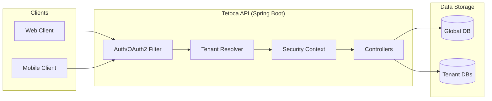

# API Contracts

This document outlines the REST API contracts for the Tetoca API. It details the multi-tenant architecture, authentication mechanisms (including OAuth2), and the definitive endpoint definitions derived from the current controllers.

## Architecture & Tenancy Overview

All API interactions must adhere to strict multi-tenant isolation.
- **Tenant Context Resolution**: Endpoints interacting with tenant data resolve the `tenantId` (often via path variable or JWT claim) to route database queries appropriately.
- **Context Clearing**: The `TenantContextHolder` must be cleared at the end of each request in a `finally` block to prevent ThreadLocal leaks in the Tomcat/Netty thread pool and avoid data bleeding.
- **MDC Logging**: Every log generated during a request injects the resolved Tenant ID into the Mapped Diagnostic Context (MDC) for full traceability.

---

## Authentication & Authorization

All secure endpoints require a valid JSON Web Token (JWT) provided in the `Authorization: Bearer <token>` header.

### Authentication Endpoints

| Endpoint | Method | Role/Purpose | Description |
|:---|:---|:---|:---|
| `/api/auth/admin/login` | `POST` | `SAAS_ADMIN` | Authenticates SaaS Administrator using email and password. Returns a JWT. |
| `/api/auth/worker/login/{tenantId}` | `POST` | `WORKER` | Authenticates a worker (e.g., admin, operator) for a specific tenant. The `tenantId` routes the authentication to the correct database. |
| `/api/auth/client/oauth` | `POST` | `CLIENT` (OAuth2) | Authenticates or registers an end-client using an OAuth2 provider token. |

**OAuth2 Workflow for Clients:**
The OAuth2 client endpoints receive an identity provider token (e.g., from Google). The backend validates this external token against the provider, creates or retrieves the user in the Global database, and then issues a Tetoca JWT containing the `CLIENT` role.

---

## Endpoints

### Administrator Operations

These endpoints manage global entities, specifically the tenant companies themselves. They are implemented in the `CompanyController`.

**Authorization:** Requires `ROLE_SAAS_ADMIN`.
**Base Path:** `/api/admin/companies`

| Endpoint | Method | Purpose | Response Type |
|:---|:---|:---|:---|
| `/api/admin/companies` | `POST` | Register a new tenant company and trigger asynchronous DB provisioning. | `CompanyResponse` (201 Created) |
| `/api/admin/companies/{id}` | `GET` | Retrieve details of a specific company by its ID. | `CompanyResponse` (200 OK) |
| `/api/admin/companies` | `GET` | List all registered companies. | `List<CompanyResponse>` (200 OK) |
| `/api/admin/companies/{id}` | `PUT` | Update general data of an existing company. | `CompanyResponse` (200 OK) |
| `/api/admin/companies/{id}` | `DELETE` | Logically delete a company and mark its instance as removed. | `Void` (204 No Content) |

#### DTO Structures

In accordance with strict DTO management, JPA entities are never exposed directly to the presentation layer.

**`CompanyRegistrationRequest`**
Used for `POST /api/admin/companies`.

| Field | Type | Description |
|:---|:---|:---|
| `company.name` | String | Company legal name |
| `company.ruc` | String | Tax identification number |
| `company.email` | String | Contact email |
| `company.categoryCode` | Integer | Business category classification code |
| `instance.tenantId` | String | Unique string identifier for the tenant schema/DB |
| `instance.dbName` | String | Database name for provisioning |
| `instance.dbUri` | String | JDBC URI for the tenant database |
| `instance.dbUser` | String | Database username |
| `instance.dbPassword` | String | Database password |
| `instance.dbTypeCode` | Integer | Database type identifier |

**`CompanyRequest`**
Used for `PUT /api/admin/companies/{id}`. Contains only the `company` fields from the registration request (the instance configuration is immutable post-creation).

**`CompanyResponse`**

| Field | Type | Description |
|:---|:---|:---|
| `id` | Integer | Internal global ID |
| `name` | String | Company name |
| `ruc` | String | Tax identification number |
| `email` | String | Contact email |
| `category` | String | Business category name |
| `state` | String | Current status (e.g., Active) |
| `tenantId` | String | Unique tenant identifier |
| `recordStatus` | String | Status flag (e.g., 'A' for active) |
| `registerDate` | Integer | Registration date (YYYYMMDD) |

---

### Tenant Client Operations

Endpoints for end-users interacting with a specific tenant.

**Authorization:** Varies (Public or `ROLE_CLIENT`).

| Endpoint | Method | Auth | Purpose |
|:---|:---|:---|:---|
| `/api/tenant/{tenantId}/public/agencies` | `GET` | None | Paged list of active agencies for a tenant. |
| `/api/tenant/{tenantId}/public/agencies/{agencyId}` | `GET` | None | Details of a specific agency and its active queues. |
| `/api/tenant/{tenantId}/queues/{queueId}/join` | `POST` | `ROLE_CLIENT` | Join a queue. Request requires push token (e.g. Expo). |

---

### Tenant Operator Operations

Endpoints for tenant operators managing queues and serving clients.

**Authorization:** Requires `ROLE_OPERATOR`.

| Endpoint | Method | Purpose |
|:---|:---|:---|
| `/api/tenants/{tenantId}/operator/queues/{queueId}/call-next` | `POST` | Call the next waiting client in a queue. Changes turn status to 'LLAMANDO'. |
| `/api/tenants/{tenantId}/operator/turns/{turnId}/complete` | `POST` | Mark a turn as 'ATENDIDO' (completed). |
| `/api/tenants/{tenantId}/operator/turns/{turnId}/mark-as-absent` | `POST` | Mark a turn as 'AUSENTE' (no-show). |

> **Note:** Additional Tenant Administration endpoints (for roles like Admin Empresa, Admin División) are in development and will be documented upon implementation.
