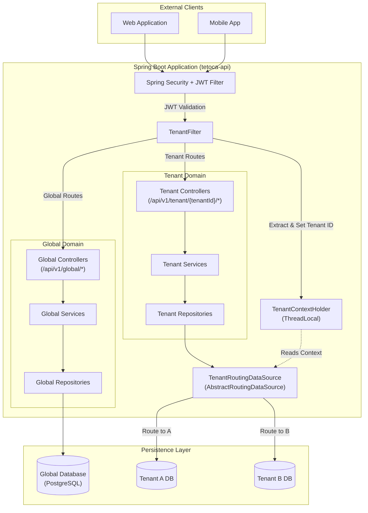

# Architecture

This document outlines the architectural decisions and system design of the `tetoca-api` multi-tenant SaaS backend. It describes the data isolation strategy, security filtering, and database provisioning flows.

---

## System Topology

The system is built on a **Database-per-Tenant** architecture using Spring Boot. This approach guarantees strict data isolation, high security, and clear separation between global configuration data and customer-specific operational data.

### Global vs. Tenant Separation

- **Global Layer**: Manages shared infrastructure, tenant registration (companies), user authentication, and billing. It routes requests to the correct tenant database.
- **Tenant Layer**: Contains the core business logic and operational data specific to each tenant. Requests to this layer are dynamically routed to a dedicated database schema or instance.

---

## Core Components

### 1. Tenant Context Management

To handle multi-tenancy dynamically, every request destined for a tenant-specific endpoint requires resolving the active tenant.

- **`TenantFilter`**: Intercepts HTTP requests and extracts the `tenantId` from the URL path (e.g., `/api/v1/tenant/{tenantId}/...`) or HTTP headers.
- **`TenantContextHolder`**: Stores the resolved `tenantId` in a `ThreadLocal` variable. It is strictly cleared in the `finally` block of the filter to prevent context leaks and data bleeding across Tomcat/Netty threads.

### 2. AbstractRoutingDataSource

The `TenantRoutingDataSource` extends Spring's `AbstractRoutingDataSource`. 

During any JPA/Hibernate database transaction, Spring queries this component to determine the current lookup key (the `tenantId`). The datasource then delegates the connection to the correct physical database instance associated with that tenant. If the context is empty, it falls back to the Global database or throws an error (depending on configuration).

### 3. JWT Filtering and Security

Authentication is strictly managed via a `JwtAuthenticationFilter`. 

When a user authenticates, the JWT includes the user's details and potentially their authorized tenant claims. The filter parses the token, establishes the `SecurityContext`, and allows the request to proceed. 

Because `tetoca-api` manages both Global and Tenant scopes:
- **Global Routes**: Accessible by system administrators or for login/registration.
- **Tenant Routes**: Require the user's JWT to hold valid authorizations for the requested `tenantId`.

### 4. Flyway and Database Provisioning

Database migrations are managed via **Flyway** with strict separation:

- `db/migration/global`: Scripts applied solely to the global database.
- `db/migration/tenant`: Scripts applied individually to every newly provisioned tenant database.

When a new Company is registered via the `CompanyManagementService`, an event triggers the `DatabaseProvisioningService`. This service connects to the database server, creates a new schema/database for the tenant, and immediately applies the tenant Flyway scripts to ensure the new database has the correct DDL structure before the tenant's first request.

---

## Design Principles and Guidelines

1. **Strict DTO Management**: JPA `@Entity` classes are never exposed in REST endpoints. All inputs/outputs rely on DTO records.
2. **Immutability of Migrations**: `ddl-auto` is strictly disabled in production. All schema changes use idempotent Flyway migrations.
3. **MDC Logging**: The `tenantId` is injected into the SLF4J/Logback `Mapped Diagnostic Context` (MDC) so all logs clearly attribute actions to the correct tenant.
4. **Integration Testing**: All data access components are tested using Testcontainers to accurately replicate multi-datasource routing in PostgreSQL.
