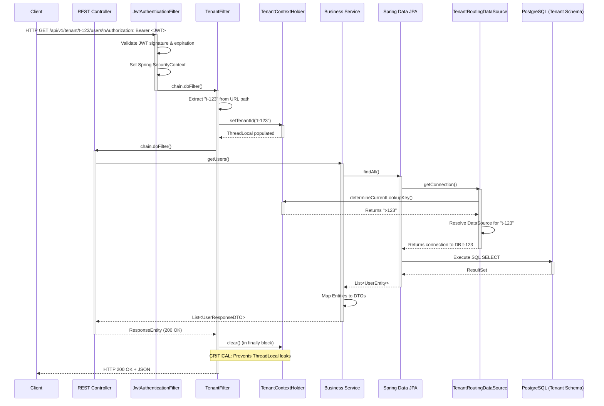
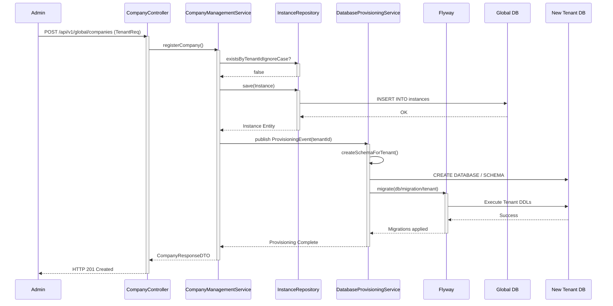

# Multi-Tenant Data Flow

This document details the lifecycle of a request flowing through the `tetoca-api` multi-tenant architecture. It explains how authentication, context resolution, and database routing are executed securely and reliably.

---

## Request Lifecycle

The system utilizes an interception and thread-local context pattern to route multi-tenant requests.

---

## Key Mechanisms

### Authentication (JwtAuthenticationFilter)

Before tenant routing occurs, the request must be authenticated. The `JwtAuthenticationFilter` validates the token provided in the `Authorization` header. It establishes the identity of the user but does not set the database routing context.

### Context Extraction (TenantFilter)

The `TenantFilter` operates after authentication. For any request matching the `/api/v1/tenant/{tenantId}/**` pattern:
1. It extracts the `{tenantId}` variable.
2. It ensures the authenticated user (from `SecurityContext`) has the authorization to access this tenant.
3. It sets the `TenantContextHolder`.

### Data Source Routing (TenantRoutingDataSource)

When Spring Data JPA requires a database connection, it delegates to the `DataSource` bean. In `tetoca-api`, this bean is the `TenantRoutingDataSource` (extending `AbstractRoutingDataSource`).
It overrides `determineCurrentLookupKey()`, which retrieves the active ID from `TenantContextHolder`. It then fetches the corresponding JDBC connection pool for that specific database.

### Context Clearing

Due to thread reuse in modern web servers (Tomcat/Netty), if a `ThreadLocal` is not cleared, a subsequent request processed by the same thread might accidentally inherit the previous request's tenant context. This causes catastrophic data bleeding. 
Therefore, `TenantContextHolder.clear()` is strictly called in a `finally` block within `TenantFilter`, guaranteeing execution even if the request throws an unhandled exception.

---

## New Tenant Provisioning Flow

When a new customer signs up, a sequence of events orchestrates the creation of their isolated environment.

